# TGScripts

**PixInsight tools for astronomical image processing, by Thorsten Glebe.**

TGScripts brings together original scripts and enhanced versions of community tools for imaging-list planning, star reduction, mask creation, narrowband processing, intensity matching, linear master blending, deconvolution, subframe quality review, and optical inspection. The collection also includes a starting point for developing your own PixInsight scripts.

[Installation](#installation) · [Script overview](#script-overview) · [Script gallery](#script-gallery) · [Help and troubleshooting](#help-and-troubleshooting) · [Credits and license](#credits-and-license)

## Installation

Install through PixInsight's update system to receive the scripts and their bundled documentation.

1. Open **Resources → Updates → Manage Repositories**.
2. Add this repository URL:

   ```text
   https://norman123al.github.io/TGScripts/TGScripts_repository/
   ```

3. Select **Resources → Updates → Check for Updates** and install the available TGScripts update. Restart PixInsight if prompted to complete installation.
4. Open a script from **Script → TG Scripts**. The newer tools appear as **Astro Bucket List**, **Linear Master Blend**, **LRGB Deconvolution Match**, **ROI Linear Fit**, **Star Spike Protection Mask**, and **Subframe Quality Review**.

To try a newly added script before the next updater release, download or clone this repository and use **Script → Execute Script File** to open its JavaScript file from `TGScripts_repository/src/scripts/TGScripts/`.

<details>
<summary>Show installation screenshots</summary>

**Manage repositories**


**Check for updates**


</details>

### Requirements

- **PixInsight:** all current repository scripts require **PixInsight 1.9.5 or later with the V8 scripting engine**. The older scripts and their shared libraries have been migrated to V8, including their dialogs, preview controls, and process constants.
- **LRGB Deconvolution Match:** requires an installed, licensed **BlurXTerminator** with its AI model.
- **BBStarReduction:** automatic starless-image generation requires [StarXTerminator](https://www.rc-astro.com/resources/StarXTerminator/) configured with an AI model and a target of at least **512 × 512 pixels**. You can instead provide an existing, matching starless image without StarXTerminator.

The packaged updater release may lag behind the repository source. For manual execution, keep each script with its bundled helpers and the `lib` folder. The update manifest may accept older PixInsight versions; the current scripts require the version listed above.

## Script overview

| Task | Script | Version | What it does | Last&nbsp;update |
| --- | --- | --- | --- | --- |
| Inspect image quality | [AberrationInspectorTG](#aberrationinspectortg) | 2.2.0 | Builds a configurable grid of image crops for comparing stars across the field. | 2026&#8209;10&#8209;30 |
| Compare corners | [AberrationSpotterTG](#aberrationspottertg) | 2.2.0 | Combines the four corners and, optionally, the center in one inspection image. | 2026&#8209;10&#8209;30 |
| Plan imaging targets | [Astro Bucket List](#astro-bucket-list) | 0.12.0 | Organizes Stellarium target lists, tracks imaging status, and displays finder charts and DSS images. | 2026&#8209;10&#8209;30 |
| Reduce stars | [BBStarReduction](#bbstarreduction) | 1.3.0 | Applies Bill Blanshan's three methods using automatic or existing starless data, with comparison previews. | 2026&#8209;10&#8209;30 |
| Select colors | [ColorMaskTG](#colormasktg) | 2.2.0 | Creates masks from hue, intensity, and saturation ranges. | 2026&#8209;10&#8209;30 |
| Isolate emission | [CSTG](#cstg) | 2.2.0 | Subtracts the broadband continuum contribution from a narrowband image. | 2026&#8209;10&#8209;30 |
| Enhance dark detail | [DarkStructureEnhanceTG](#darkstructureenhancetg) | 2.4.0 | Enhances dark structures in stretched images, with a parameter comparison grid. | 2026&#8209;10&#8209;30 |
| Tune deconvolution | [DeconvolutionPreviewTG](#deconvolutionpreviewtg) | 2.3.0 | Compares synthetic PSF settings on a preview and applies deconvolution to the full image. | 2026&#8209;10&#8209;30 |
| Combine narrowband and RGB | [EmissionLineIntegrationTG](#emissionlineintegrationtg) | 2.2.1 | Adds continuum-subtracted narrowband emission to RGB channels. | 2026&#8209;10&#8209;30 |
| Blend linear masters | [Linear Master Blend](#linear-master-blend) | 1.20.1 | Normalizes and integrates two linear masters using measured quality and adjustable sharpness preference. | 2026&#8209;10&#8209;19 |
| Support deconvolution | [LocalSupportMask](#localsupportmask) | 2.2.0 | Generates a local support mask for deconvolution deringing. | 2026&#8209;10&#8209;30 |
| Match L and RGB sharpness | [LRGB Deconvolution Match](#lrgb-deconvolution-match) | 1.13.2 | Uses BlurXTerminator to match stellar halo profiles with estimated sharpening, independent FWHM checks, and blink previews. | 2026&#8209;10&#8209;30 |
| Match intensity scales | [ROI Linear Fit](#roi-linear-fit) | 1.1.6 | Measures a fit in a selected region and applies it to the full target image. | 2026&#8209;10&#8209;04 |
| Protect diffraction spikes | [Star Spike Protection Mask](#star-spike-protection-mask) | 1.7.2 | Builds a soft mask protecting bright stellar cores and their spikes. | 2026&#8209;10&#8209;10 |
| Review WBPP subframes | [Subframe Quality Review](#subframe-quality-review) | 0.42.3 | Reviews registered lights with four rankings, sky quality and transparency indicators, blink, plots, and journal-based rejection and undo. | 2026&#8209;10&#8209;30 |
| Develop scripts | [TGScriptSkeleton](#tgscriptskeleton) | 1.6 | Provides a reusable dialog, image preview, and process-instance framework. | 2026&#8209;10&#8209;19 |

Versions follow the declarations in the repository source.

Dates use **YYYY-MM-DD** and reflect the latest Git commit touching each script’s main JavaScript file; documentation and shared-library changes are excluded.

## Script gallery

Each entry links to its source file. Most scripts also provide a documentation button in PixInsight; the bundled guides contain parameter details and examples. Screenshots show actual PixInsight interfaces. The redesigned tools, Astro Bucket List, and Subframe Quality Review setup were captured on **2026-10-30**. Some populated examples remain from earlier releases, as identified in their captions. Expand an interface below to view it.

### AberrationInspectorTG

**Version:** 2.2.0 · **Last update:** 2026-10-30

Creates an **n × n mosaic** of crops sampled across an image to compare star shapes and field-dependent aberrations. Choose **2–9 rows and columns**, panel sizes up to **2048 × 2048 pixels**, spacing, and background brightness. Odd-sized grids include the center.

The redesigned dialog can open an image directly and shows the requested output dimensions. Apply creates a new inspection image and leaves the dialog open for another comparison. Settings can be saved as a process icon.

Based on Mike Schuster's AberrationInspector. [Source](TGScripts_repository/src/scripts/TGScripts/AberrationInspectorTG.js) · [Guide](TGScripts_repository/doc/scripts/AberrationInspectorTG/AberrationInspectorTG.html)

<details>
<summary>View AberrationInspectorTG interface</summary>

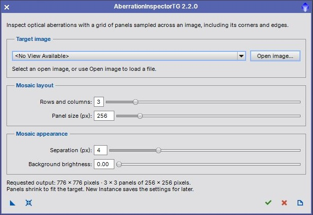

</details>

### AberrationSpotterTG

**Version:** 2.2.0 · **Last update:** 2026-10-30

Collects the **four corners of a selected image**, with an optional center crop, into one inspection image. Set horizontal and vertical crop sizes up to **2048 × 2048 pixels**, spacing, and background brightness to compare optical performance across the field.

Select an open image or load one from the dialog. The output summary shows the montage dimensions; Apply creates a new image and keeps the dialog open. Settings can be saved as a process icon.

Based on David Serrano's AberrationSpotter. [Source](TGScripts_repository/src/scripts/TGScripts/AberrationSpotterTG.js) · [Guide](TGScripts_repository/doc/scripts/AberrationSpotterTG/AberrationSpotterTG.html)

<details>
<summary>View AberrationSpotterTG interface</summary>

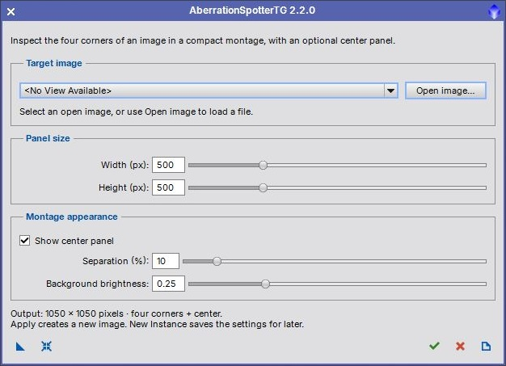

</details>

### Astro Bucket List

**Version:** 0.12.0 · **Last update:** 2026-10-30

Organizes **Stellarium observing lists** in a flat table with a Constellation column and configurable planning months. Each object has its own row; there are no collapsible groups. Separate **Filter objects** and **Sort rows** panels distinguish which targets are shown from their display order. **Reset filters** clears all view filters while keeping sort order and export checks. **Sort by** and optional **Then by** support two criteria with independent directions, such as Dec increasing followed by largest object size. Filter targets by constellation, object type, month and imaging state, sort by calendar month, apparent size, RA or Dec, add objects by catalog identifier, and record imaging status, dates, descriptions, filters, and notes. Export checkboxes select objects for a Stellarium list independently of their imaging status. Use Ctrl-click or Shift-click to highlight multiple rows, then **Check selected** to check them together; **Check shown** checks the entire filtered view. Import, save, and export collections as `.sol` files.

The **Table**, **Finder chart**, and **DSS survey image** tabs combine list management with target previews. SIMBAD lookups update catalog information and apparent sizes. Landscape finder charts offer **Modern Editorial** (dark sky, sans-serif labels) and **Vintage Atlas** (ivory paper, sepia markings, serif labels). Both provide clearer labels, a separate title band, coordinates, a symbol key and an angular scale. **Constellation borders** draws dashed region boundaries by default, with an option to hide them. Use the preview tabs to open the charts and DSS images. They use configured local Gaia catalogs, including DR3/SP, or bundled bright stars; default coverage is the larger of the object diameter and 5 degrees, with automatic fitting off. **Fainter NGC/IC** controls catalog depth with the actual magnitude limits shown. Caldwell, Collinder clusters, supernova remnants and Mandel–Wilson nebulae have independent catalog checkboxes; unavailable local catalogs are disabled. Local charts work offline, while new SIMBAD lookups and DSS downloads require internet access. DSS fields are limited to **5–120 arcminutes**, with oversized targets using the maximum width.

Requires **PixInsight 1.9.5+ with V8** and the bundled CatalogStarGenerator and AnnotateImage libraries. Save working collections outside the installation directory. The New Instance triangle stores the saved collection path in a process icon. [Source](TGScripts_repository/src/scripts/TGScripts/AstroBucketList.js) · [Guide](TGScripts_repository/doc/scripts/AstroBucketList/AstroBucketList.html) · [PiDoc source](TGScripts_repository/doc/source/AstroBucketList.pidoc)

<details>
<summary>View Astro Bucket List interface</summary>

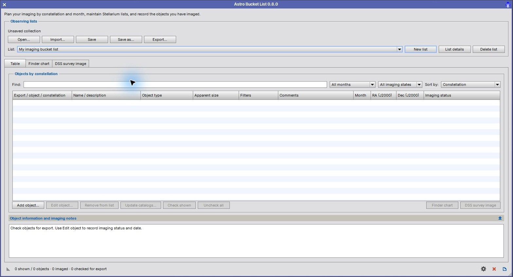

</details>

### BBStarReduction

**Version:** 1.3.0 · **Last update:** 2026-10-30

Reduces stars in a **stretched grayscale or RGB image** using Bill Blanshan's **Transfer, Halo, or Star** method. Generate a temporary starless image with StarXTerminator, or select an **existing starless image** with matching dimensions, channels, alignment, and stretch.

Use a preview of at least **64 × 64 pixels** to create a labeled comparison grid. Apply processes the full target and creates a **new image by default**; disable that option to modify the target with one Undo step. Automatic star removal requires a configured StarXTerminator and a target of at least **512 × 512 pixels**; an existing starless image avoids that dependency.

[Source](TGScripts_repository/src/scripts/TGScripts/BBStarReduction.js) · [Guide](TGScripts_repository/doc/scripts/BBStarReduction/BBStarReduction.html)

<details>
<summary>View BBStarReduction interface</summary>

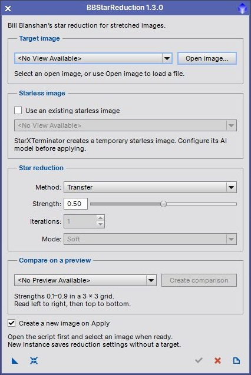

</details>

### ColorMaskTG

**Version:** 2.2.0 · **Last update:** 2026-10-30

Creates a **grayscale mask from an RGB color range**, refined by intensity and saturation limits. Choose a preset or custom hue interval, including ranges crossing red, then select Linear, Chrominance, Lightness, or Inverse lightness weighting. Strength, blur layers, and output name control the result.

Select or open the target from the dialog. Apply creates a new 32-bit floating-point mask and leaves the source unchanged; assign the result as an image mask in PixInsight.

Based on Rick Stevenson's ColorMask. [Source](TGScripts_repository/src/scripts/TGScripts/ColorMaskTG.js) · [Guide](TGScripts_repository/doc/scripts/ColorMaskTG/ColorMaskTG.html)

<details>
<summary>View ColorMaskTG interface</summary>

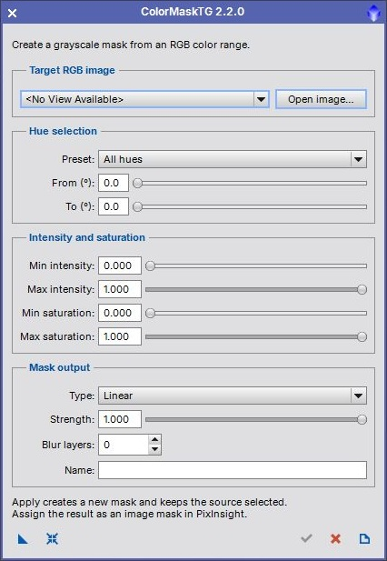

</details>

### CSTG

**Version:** 2.2.0 · **Last update:** 2026-10-30

Performs **continuum subtraction** to isolate emission-line signal in a linear narrowband image. Supply an aligned grayscale narrowband image and an equally sized broadband image or RGB channel. An optional grayscale star mask excludes bright pixels from estimation.

The script matches the broadband mean to the narrowband image and estimates the subtraction factor from the black-pixel response curve. Optional noise reduction and a **native PixInsight diagnostic plot** help inspect the result. Apply creates a new 32-bit floating-point emission image and keeps both inputs unchanged.

Based on Hartmut V. Bornemann's CS script. [Source](TGScripts_repository/src/scripts/TGScripts/CSTG.js) · [Guide](TGScripts_repository/doc/scripts/CSTG/CSTG.html)

<details>
<summary>View CSTG interface</summary>

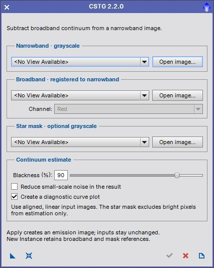

</details>

### DarkStructureEnhanceTG

**Version:** 2.4.0 · **Last update:** 2026-10-30

Enhances **dark structures in stretched grayscale or RGB images**, such as dust lanes, using a wavelet-derived mask. Adjust the mask layers, scaling function, enhancement amount, and iterations; optionally retain the generated mask.

A preview of at least **64 × 64 pixels** can generate a **3 × 3 comparison grid**, with layers across columns and amount down rows. Apply always processes the full target, creating a **new image by default** or modifying the target with one Undo step when that option is disabled.

Based on DarkStructureEnhance by Carlos Sonnenstein and Oriol Lehmkuhl. [Source](TGScripts_repository/src/scripts/TGScripts/DarkStructureEnhanceTG.js) · [Guide](TGScripts_repository/doc/scripts/DarkStructureEnhanceTG/DarkStructureEnhanceTG.html)

<details>
<summary>View DarkStructureEnhanceTG interface</summary>

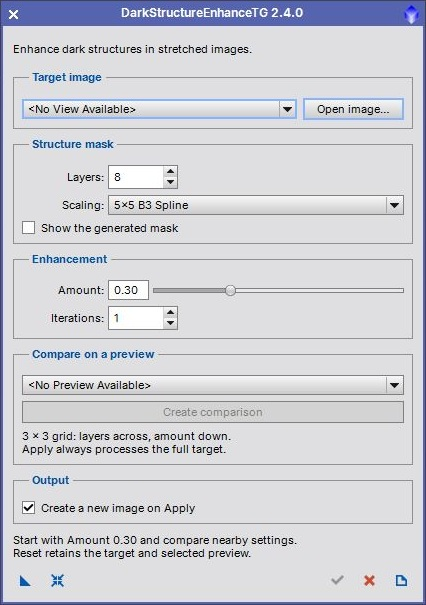

</details>

### DeconvolutionPreviewTG

**Version:** 2.3.0 · **Last update:** 2026-10-30

Compares deconvolution results across the **sigma and shape of a synthetic point spread function (PSF)**. Use a preview of at least **64 × 64 pixels** on a linear grayscale or RGB image, then set the start, step, and count for each PSF parameter. Controls include iterations, dark deringing, and an optional registered grayscale local support mask.

The comparison grid varies sigma across columns and shape down rows. **Apply processes the full target using the Start values**, creating a new image by default; disabling that option modifies the target with one Undo step.

Based on Juan M. Gómez's DeconvolutionPreview. [Source](TGScripts_repository/src/scripts/TGScripts/DeconvolutionPreviewTG.js) · [Guide](TGScripts_repository/doc/scripts/DeconvolutionPreviewTG/DeconvolutionPreviewTG.html)

<details>
<summary>View DeconvolutionPreviewTG interface</summary>

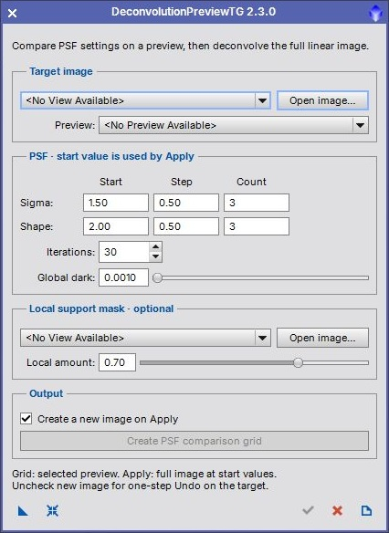

</details>

### EmissionLineIntegrationTG

**Version:** 2.2.1 · **Last update:** 2026-10-30

Adds **continuum-subtracted narrowband emission to a linear RGB image**. Supply aligned, equally sized grayscale narrowband data for at least one RGB channel, with independent amplification controls. An optional grayscale star mask affects continuum estimation only; channels without narrowband input remain unchanged.

The compact dialog can open each input directly. Its magnifier opens a **separate Original RGB / With emission comparison** for a selected preview, while estimation uses the full images. Apply creates a new RGB image by default, or modifies the target with one Undo step when that option is disabled. Separate emission images can be retained.

Based on Hartmut V. Bornemann's EmissionLineIntegration. [Source](TGScripts_repository/src/scripts/TGScripts/EmissionLineIntegrationTG.js) · [Guide](TGScripts_repository/doc/scripts/EmissionLineIntegrationTG/EmissionLineIntegrationTG.html)

<details>
<summary>View EmissionLineIntegrationTG interface</summary>


</details>

### Linear Master Blend

**Version:** 1.20.1 · **Last update:** 2026-10-19

Normalizes and integrates **two aligned linear master images** using measured source quality. Preview automatically chooses the master with the lower combined stellar **FWHM** as the brightness reference. It matches the other master's stellar flux and local background to that reference independently in each channel.

Integration starts with a base balance of **40% PSF Signal Weight, 40% PSF SNR, and 20% inverse combined FWHM**. **Sharpness preference** (0–8, default **1**) then gives extra weight to the master with narrower stars. Set it to **0** to use the base balance alone; higher values favor sharpness more strongly and can reduce the noise benefit of the other master. Recalculate Preview after changing it. The resulting weights apply to every pixel and all RGB channels. This is a weighted average of the complete masters; including a source with broader stars can broaden the output stars, so inspect both detail and noise.

The **Output preview** supports zoom, pan, display stretching, and blinking against either master. The **Measurements** tab shows the stellar-flux fit, selected reference, noise, FWHM X/Y, PSF quality metrics, source contributions, and output measurements. Create produces a **new 32-bit floating-point linear image** using the preview's normalization and weights; both originals remain unchanged.

Use registered, cropped floating-point images with identical dimensions and matching grayscale or RGB channels, without alpha channels. Correct gradients first and provide at least **10 reliable matched stars per channel** for brightness matching. Requires PixInsight 1.9.5+ with V8. [Source](TGScripts_repository/src/scripts/TGScripts/LinearMasterBlend.js) · [Guide](TGScripts_repository/doc/scripts/LinearMasterBlend/LinearMasterBlend.html)

<details>
<summary>View Linear Master Blend interface</summary>

**Output preview**


**Measurements**

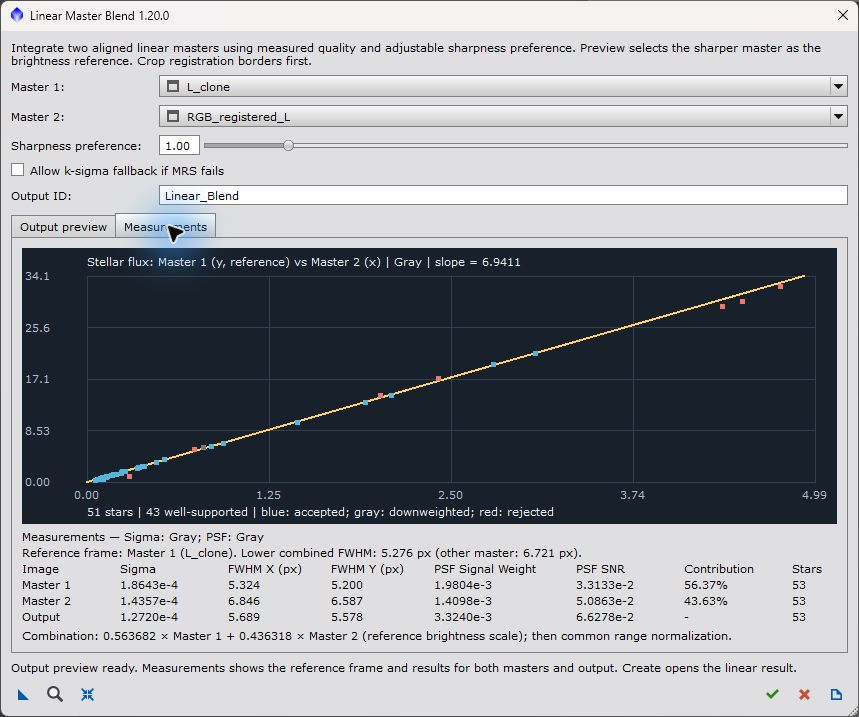

</details>

### LocalSupportMask

**Version:** 2.2.0 · **Last update:** 2026-10-30

Creates a **grayscale local support mask for deconvolution deringing** from a linear grayscale or RGB main image. Adjust mask strength, scale, structure growth, compensation, and smoothness. RGB inputs are converted to luminance internally.

The redesigned dialog opens **separate preview images** for intermediate luminance or the star-mask overlay. Apply creates the final support mask; the source image stays unchanged.

[Source](TGScripts_repository/src/scripts/TGScripts/LocalSupportMask.js) · [Guide](TGScripts_repository/doc/scripts/LocalSupportMask/LocalSupportMask.html)

<details>
<summary>View LocalSupportMask interface</summary>

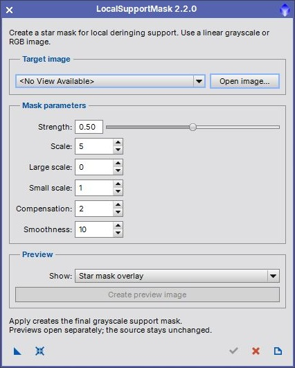

</details>

### LRGB Deconvolution Match

**Version:** 1.13.2 · **Last update:** 2026-10-30

Prepares **registered linear luminance and RGB images for LRGB composition**, including data from different telescopes and original pixel scales. Choose the sharper reference yourself or let the script select it from measured stellar FWHM. Set its BlurXTerminator **Sharpen Stars** and **Adjust Star Halos**, then inspect the **Reference before/after** preview.

The script estimates **Sharpen Stars** for the other image from the measured reference sharpening and holds that estimate fixed. It optimizes only **Adjust Star Halos**, comparing flux-normalized outer stellar profiles within your chosen halo limits. The reference result stays fixed; **Sharpen Nonstellar** is shared by both images and **Automatic PSF** remains enabled. The sharpening estimate is empirical and is not clipped; matching stops if BlurXTerminator rejects it.

Use **Matched L / RGB** to blink the deconvolved luminance against luminance extracted from the deconvolved RGB image. **FWHM comparison** plots each image before/after and the final L/RGB width comparison, with fitted lines and paired-star statistics. The **BlurXTerminator report** lists the applied settings, halo mismatch, dark-ring flags, and stopping reason. **PASS** requires both halo-profile and stellar-width checks to pass, including separate RGB-channel width checks; **REVIEW** means the results need inspection.

After reviewing the previews, use the **green checkmark** to create two new linear images, or the **blue square** to apply the results to both inputs with **one Undo step per image**. Preview calculations leave the inputs unchanged. Display stretching and brightness alignment affect only previews; neither result action stretches, combines, or saves the images to disk.

Requires **PixInsight 1.9.5+ with V8** and an installed, licensed **BlurXTerminator** with its AI model. Supply registered, equally sized floating-point grayscale L and three-channel RGB images, without alpha channels or empty registration borders. At least **20 reliable common stars and 20 usable halo profiles** are required. Registration, resampling, final stretching, and LRGB combination are separate steps. [Source](TGScripts_repository/src/scripts/TGScripts/LRGBDeconvolutionMatch.js) · [Guide](TGScripts_repository/doc/scripts/LRGBDeconvolutionMatch/LRGBDeconvolutionMatch.html)

<details>
<summary>View LRGB Deconvolution Match interface</summary>

**Reference before/after**


**Matched L / RGB**

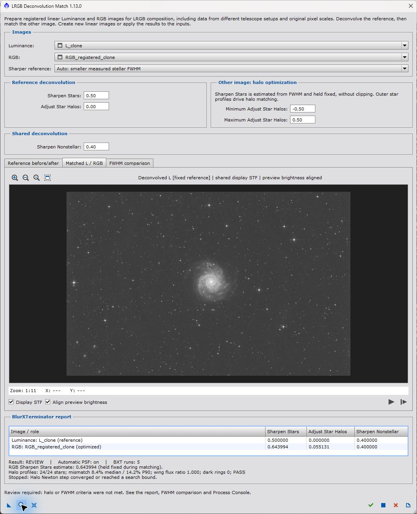

**FWHM comparison**

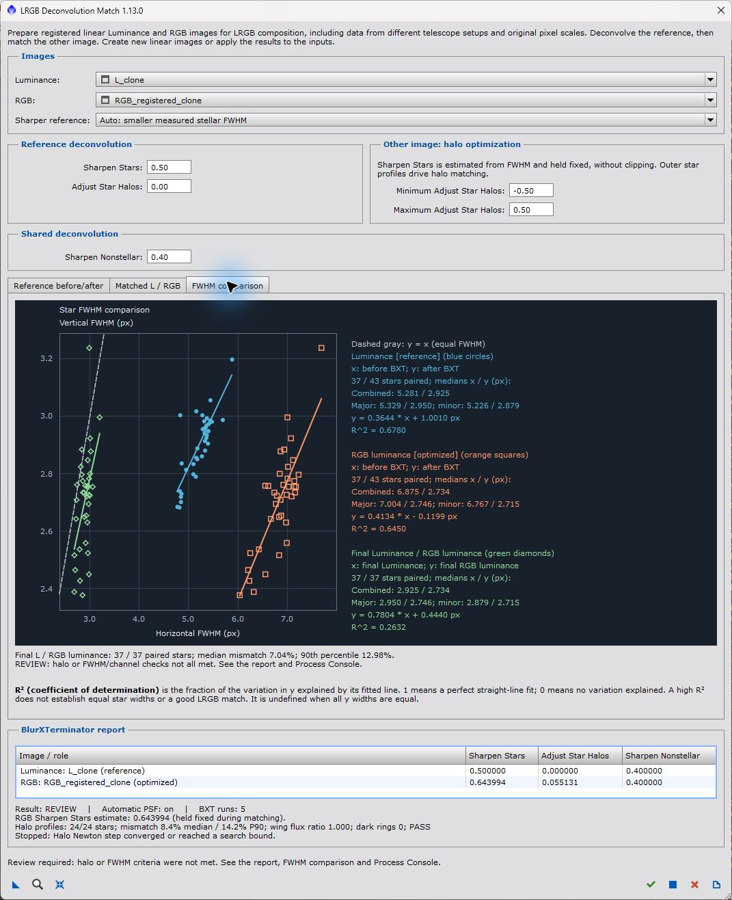

</details>

### ROI Linear Fit

**Version:** 1.1.6 · **Last update:** 2026-10-04

Matches a target image's **intensity scale** to a reference using a rectangular **region of interest (ROI)**. The script measures PixInsight's native LinearFit transformation inside that region and applies it to the **entire target**, with separate fits for RGB channels. Enter coordinates or copy them from an existing preview; inspect the fit with a scatter plot before applying it.

Use two registered main images with identical dimensions and matching color types. The reference stays unchanged; the target is modified in place with Undo support. Requires PixInsight 1.9.5+ with V8. [Source](TGScripts_repository/src/scripts/TGScripts/ROILinearFit.js)

<details>
<summary>View ROI Linear Fit interface</summary>


</details>

### Star Spike Protection Mask

**Version:** 1.7.2 · **Last update:** 2026-10-10

Creates a **full-size grayscale protection mask for bright stars and diffraction spikes**. It follows the luminance profiles of stellar cores and spikes, with controls for star selection, spike detection, core size, mask growth, and blur. Preview the mask, compare it with the source, and optionally save the result as a 32-bit floating-point XISF image.

Designed for a **stretched stars-only image** with roughly straight spikes on two perpendicular axes. Detection uses actual pixel values, not the STF display stretch. **Black protects, white permits processing; apply the mask with Invert Mask off.** The source pixels remain unchanged. Requires PixInsight 1.9.5+ with V8. [Source](TGScripts_repository/src/scripts/TGScripts/StarSpikeProtectionMask.js)

<details>
<summary>View Star Spike Protection Mask interface</summary>


</details>

### Subframe Quality Review

**Version:** 0.42.3 · **Last update:** 2026-10-30

Reviews **registered light frames from a completed WeightedBatchPreprocessing (WBPP) run** to help decide which original exposures to exclude before rerunning WBPP. It measures PSF signal weight, star count, FWHM, eccentricity, sky brightness, relative transparency, and sky quality, with optional center/corner measurements and guiding-log data. **Score ranges from 0 to 1; higher is better.** Scores describe relative quality within each filter/exposure group. **Below-mean Quality** reports the percentage of assessed, enabled indicators worse than their group mean. Its baseline includes manually rejected subframes and excludes masters; switching Score modes does not change its manual indicator selection.

- **Four comparison rankings:** **R1** uses manual weights for field quality; **R2** adds corners; **R3** equally weights indicators strongly correlated with PSF signal weight (absolute Pearson correlation ≥ 0.7), using PSF signal weight only as the correlation reference, with no direct R3 contribution; **R4** averages the available normalized R1–R3 ranks. Rank **1 is worst**. The **Score selection** panel identifies the current mode and offers **Include corner measurements (R2)**, **Use R3: strongly correlated KPIs**, and **Use R4: rank of ranks**. Unavailable ranks are omitted from R4, as is R2 when corner scoring is off. R3 can include qualifying individual corner FWHM/eccentricity indicators. If none qualify, R3 remains unavailable and the active Score falls back to manual evaluation.
- **Review and measurements:** shortlists the worst **10%** by default and flags missing required measurements. Sorting, a REVIEW-only filter, tooltips, and collapsible information panels help inspect individual frames. The magnifier measures the field; the adjacent **Measure corners** grid button measures the center and four corners. Repeated measurement reuses unchanged results and sky calibration; previews load when needed. Corner measurements automatically adapt parallel processing to available CPU and memory. The resizable dialog provides scrolling and collapsible panels while keeping its action bar accessible.
- **Sky indicator selection:** choose **Sky quality** (default, weight **20**), **Transparency**, or **Sky brightness** for the sky contribution to scoring. Transparency compares matched, background-subtracted stellar flux per second, relative to the best comparable reference; RGB uses green, and at least **10 common stars** are required. Sky quality combines relative transparency with exposure-normalized, pedestal-corrected sky brightness as a relative signal-to-noise proxy; the reference is **100%**, and higher values are possible. Only the selected sky indicator contributes, avoiding double-counting the three measures. These are relative comparisons, not absolute atmospheric measurements.
- **Blink frame / reference:** compare with the best scoring subframe or matching linear filter master, rotate through subframes in the visible Review order, or cycle through regions. Playback intervals of **0.10–10 seconds**, preserved zoom/pan, display stretching, and brightness alignment aid comparison without changing source pixels.
- **Quality and correlation plots:** inspect one bar per frame by value or acquisition time, with master comparison for measured indicators, a mean for non-rejected frames, and optional autofocus-start markers. **Masters receive no Score or R1–R4 ranks** and are excluded from score baselines and the REVIEW quota; they remain available for measurement comparisons and blink. Blue information buttons explain the indicators, plot legend, and calibration. Eccentricity bands use **0.42** and **0.60**; field, center, and corner eccentricity axes adapt to the data within 0–1. The scatter plot compares two selectable indicators and explains their Pearson correlation.
- **FWHM grading:** enter telescope aperture and optional **Zenith seeing** in **Input files and observing conditions**, then open the settings icon on a field, center, or corner FWHM plot. Good/Medium/Bad bands account for aperture, image scale, target altitude, wavelength, and optional optical blur. With a seeing estimate, the default Good/Medium limits are **115%/135%** of expected FWHM; otherwise fixed seeing limits are used. The dialog shows the resulting limits in pixels.
- **Sky brightness and SQM:** background uses the lowest mean of the center and four corner previews when corner scoring is enabled, otherwise the whole-image mean; RGB uses the **green channel**. Enter **Session SQM** and its local date/time to anchor relative sky-brightness estimates to the eligible exposure nearest that time. A pink dashed line marks the SQM reference, and an approximate Bortle class determines the quality shading. The log-derived time preset can be corrected directly or with **Choose**. Without SQM, select a Bortle class to calibrate with local Gaia photometry, or choose **—** to disable calibration and shading. Stars, nebulosity, gradients, and transparency affect these estimates; Bortle ranges are approximate.
- **Guiding and logs:** an optional folder supplies Autorun autofocus events and PHD2 samples matched to each exposure. Minimum, average, and maximum guiding errors appear in arcseconds, with bands based on the imaging pixel scale. **Use available guiding data** is the default; **Require guiding data** and **Ignore guiding KPI** remain available.

**FWHM, eccentricity, and sky-brightness bands are visual inspection guides; their grading settings do not change Score, REVIEW, or rejection decisions.** FWHM grading requires a configured aperture and valid image scale. Sky calibration supports luminance, green, V, and RGB green-channel data in compatible acquisition groups; separate red and blue groups can reuse a compatible measured green group's calibration. The Gaia method additionally requires sky coordinates and a configured local Gaia DR3/SP, DR3, or EDR3 catalog. Supplying SQM uses the reading directly; a missing or ambiguous reading time leaves calibration unavailable rather than falling back to Gaia.

**REVIEW is a suggestion, not a rejection decision.** Mark unwanted originals manually, then use the green checkmark to inspect and confirm the move plan. Only uniquely verified original lights are moved, preserving relative subdirectories and recording a move journal. The **Undo** arrow can restore eligible files from that journal, even after reopening the script, without overwriting existing files; scan the files and configure the rejected-originals destination first. Refresh WBPP's inputs before rerunning it. Measurements, calibration, and pending decisions last only while the dialog stays open; process instances save settings, not the measured session.

Requires **PixInsight 1.9.5+ with V8**. Supports XISF/FITS monochrome and registered, debayered OSC lights from one telescope setup. Select the WBPP output directory and a separate original-light root. Master comparisons require a matching **linear, uncropped, non-drizzled integration** with the same dimensions as the registered lights. [Source](TGScripts_repository/src/scripts/TGScripts/SubframeQualityReview.js) · [Guide](TGScripts_repository/doc/scripts/SubframeQualityReview/SubframeQualityReview.html)

<details>
<summary>View Subframe Quality Review interface</summary>

**Current setup — 0.42.3**

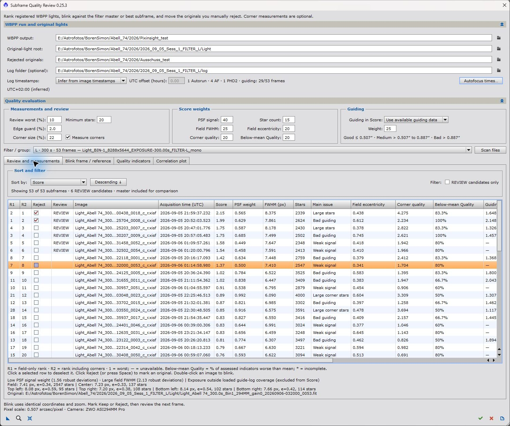

**Earlier populated examples — 0.39.14**

The following images illustrate a previously measured Abell 74 session. Their layout and scoring predate 0.42.3: current versions exclude masters from Score and rankings, use the revised R3 selection, and offer the new sky indicators. Updated populated examples will replace these in a later refresh.

**Blink frame / reference**

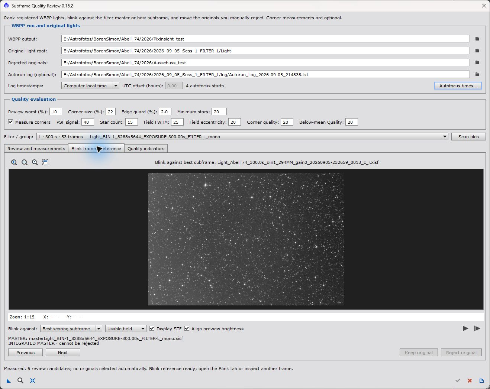

**Earlier Score plot — 0.39.14**

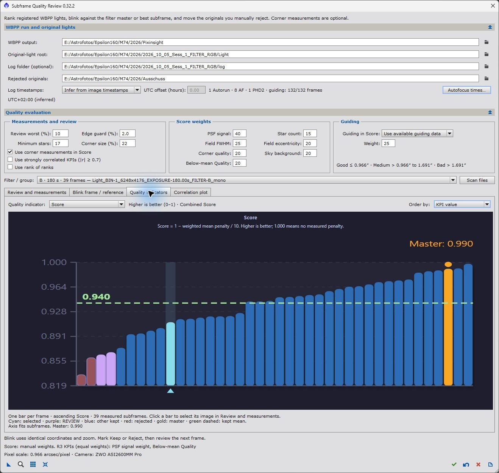

**Earlier Sky background plot — now named Sky brightness**

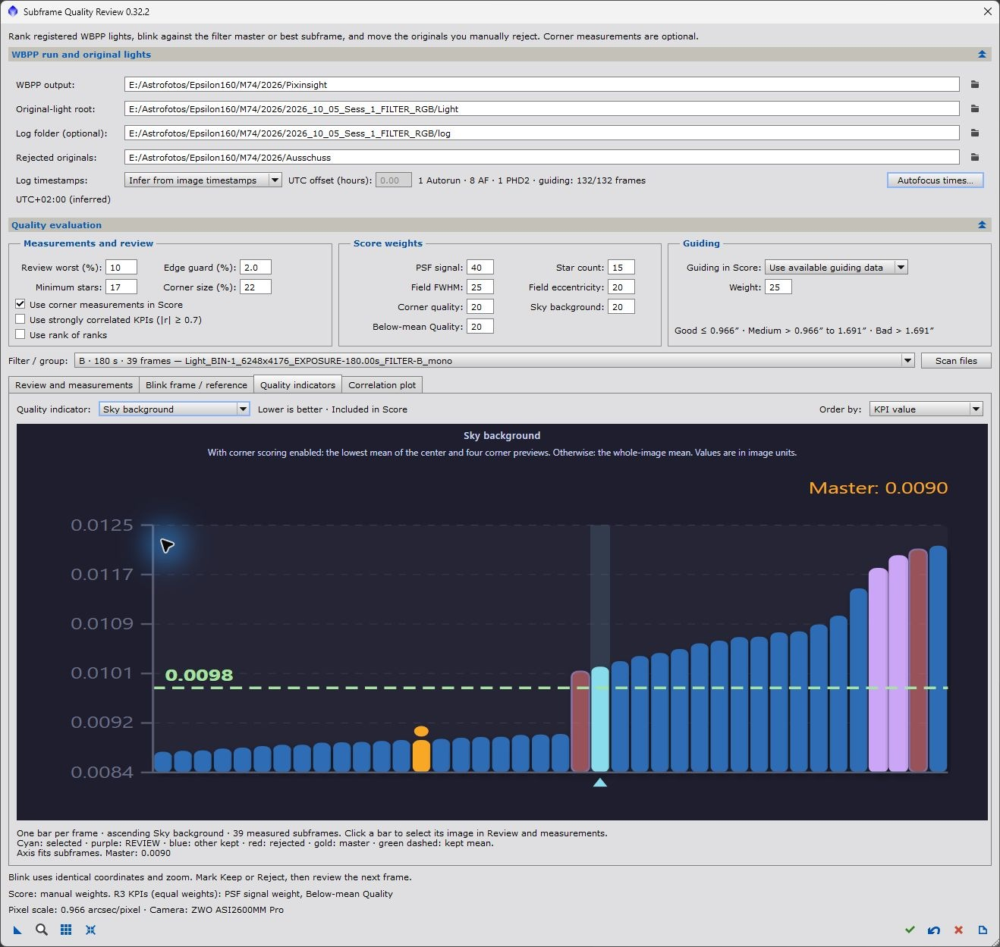

**Field FWHM — quality bands**

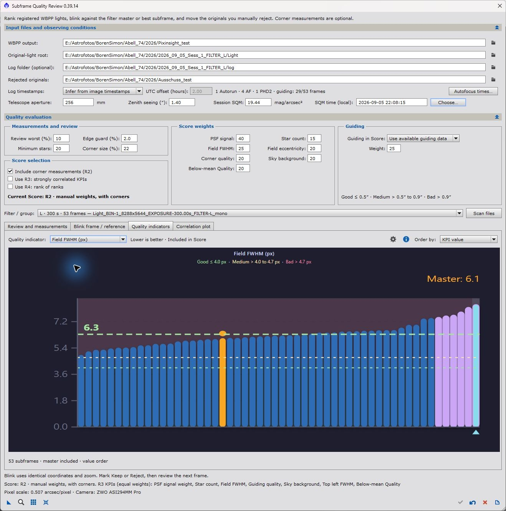

**FWHM grading settings**

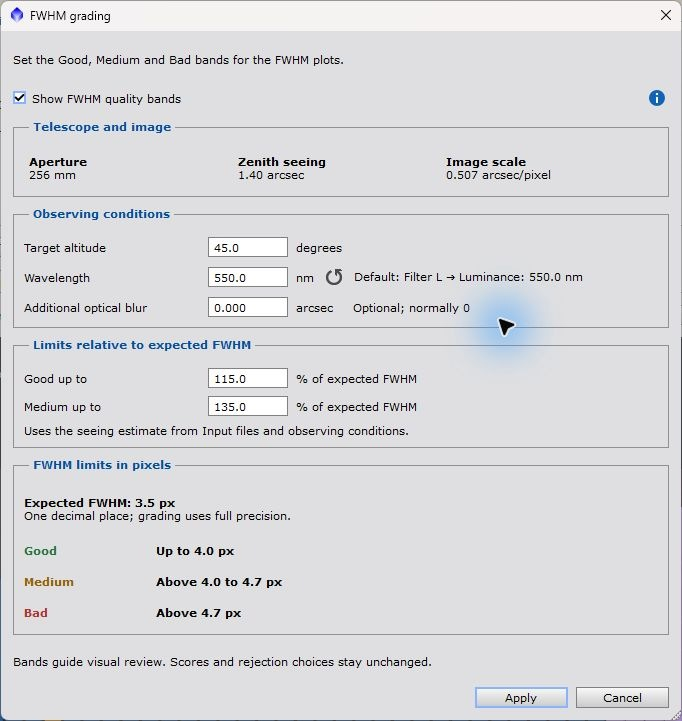

**Field eccentricity**

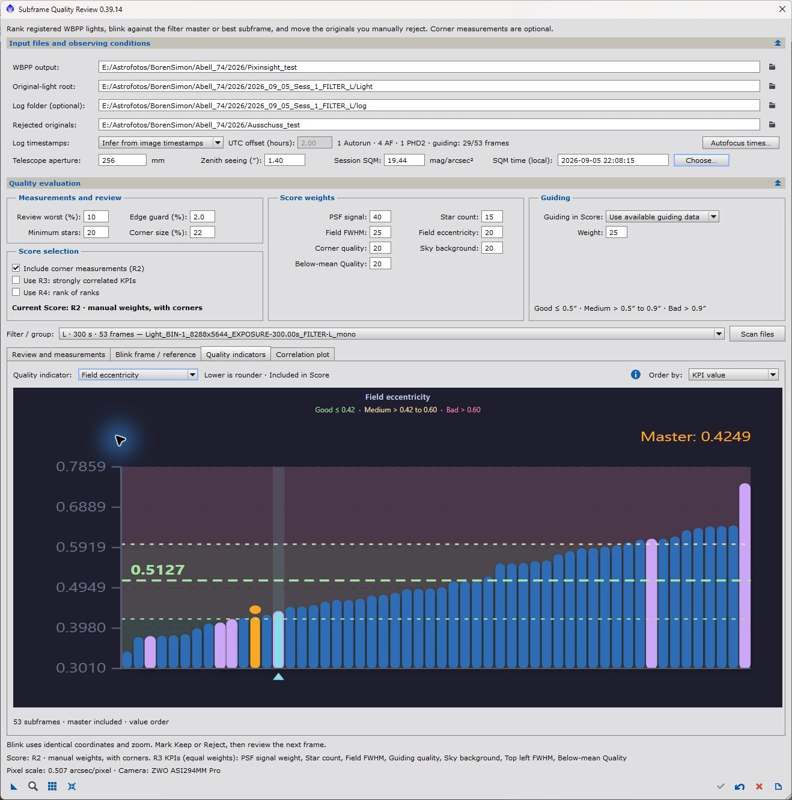

**Guiding indicators — average error**

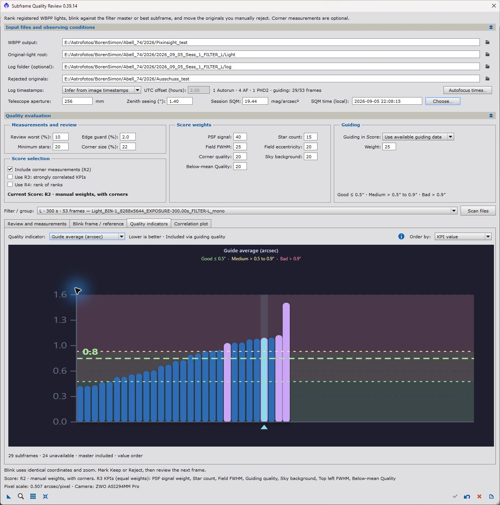

**Correlation plot**

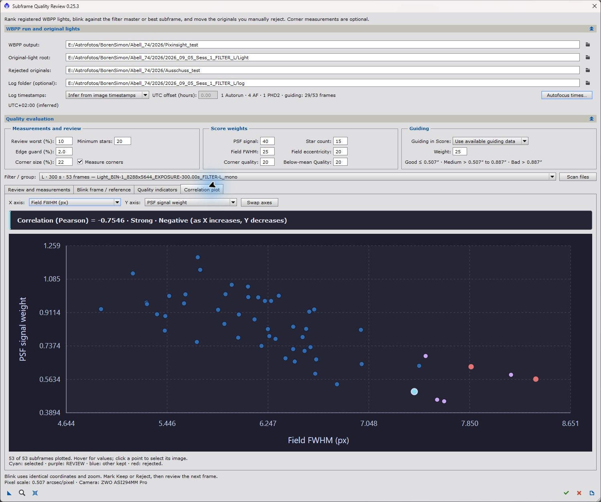

</details>

### TGScriptSkeleton

**Version:** 1.6 · **Last update:** 2026-10-19

A **development template** for building PixInsight scripts. It provides image selection, a zoomable preview with display stretching, image statistics and properties, parameter storage in process icons, and standard reset, execution, and documentation controls. Use it as a starting point for a new tool rather than as an image-processing operation.

[Source](TGScripts_repository/src/scripts/TGScripts/TGScriptSkeleton.js)

<details>
<summary>View TGScriptSkeleton interface</summary>


</details>

## Help and troubleshooting

### Documentation and reusable settings

Use a script's documentation or information button for parameter explanations and examples, where provided. The compiled guides are stored in [TGScripts_repository/doc/scripts](TGScripts_repository/doc/scripts), including the new [EmissionLineIntegrationTG guide](TGScripts_repository/doc/scripts/EmissionLineIntegrationTG/EmissionLineIntegrationTG.html).

Scripts with a **New Instance** triangle can store their settings in a PixInsight process icon. Save your process icons or project to reuse these settings in later sessions. Consult the individual guide before applying an instance to an image, since execution behavior varies by script.

### StarXTerminator in BBStarReduction

If automatic star removal fails, check the PixInsight Process Console and confirm that StarXTerminator is installed, licensed, and configured with its AI model. The automatic mode requires a target of at least **512 × 512 pixels**. Alternatively, enable **Use an existing starless image** and select a matching starless view.

### Reporting a problem

Please [open an issue](https://github.com/norman123al/TGScripts/issues) with the script name and version, your PixInsight version and operating system, steps to reproduce the problem, and the relevant console error. Include whether the input is grayscale or RGB, linear or stretched, and a main image or preview.

## Repository layout

| Location | Contents |
| --- | --- |
| [TGScripts_repository/src/scripts/TGScripts](TGScripts_repository/src/scripts/TGScripts) | The 16 menu scripts, with script-specific helpers and data. |
| [TGScripts_repository/src/scripts/TGScripts/lib](TGScripts_repository/src/scripts/TGScripts/lib) | Shared helpers and libraries used by the scripts. |
| [TGScripts_repository/doc/source](TGScripts_repository/doc/source) | PiDoc sources for the script guides. |
| [TGScripts_repository/doc/scripts](TGScripts_repository/doc/scripts) | Compiled PixInsight documentation and guide images. |
| [TGScripts_repository/images](TGScripts_repository/images) | Installation images and additional README screenshots. |
| [TGScripts_repository/updates.xri](TGScripts_repository/updates.xri) | PixInsight update manifest. |
| [TGScripts_docu](TGScripts_docu) | Documentation sources and generated documentation assets. |

The files in `lib/` support the menu scripts and are not standalone tools.

## Credits and license

Maintained by **Thorsten Glebe**. This collection includes original tools and adaptations of scripts by **Mike Schuster, David Serrano, Rick Stevenson, Hartmut V. Bornemann, Carlos Sonnenstein, Oriol Lehmkuhl, and Juan M. Gómez**. BBStarReduction implements star reduction methods by **Bill Blanshan**. Individual source files retain their original attribution and copyright notices.

The repository includes the [GNU General Public License v3.0](LICENSE). Astro Bucket List, Linear Master Blend and LRGB Deconvolution Match have their own MIT licenses: [Astro Bucket List license](TGScripts_repository/src/scripts/TGScripts/AstroBucketList-LICENSE.txt), [Linear Master Blend license](TGScripts_repository/src/scripts/TGScripts/LinearMasterBlend-LICENSE.txt) and [LRGB Deconvolution Match license](TGScripts_repository/src/scripts/TGScripts/LRGBDeconvolutionMatch-LICENSE.txt). See individual source headers for applicable notices and terms. The software is provided without warranty.

Visit Thorsten's [astrophotography gallery on AstroBin](https://www.astrobin.com/users/norman123al/).
